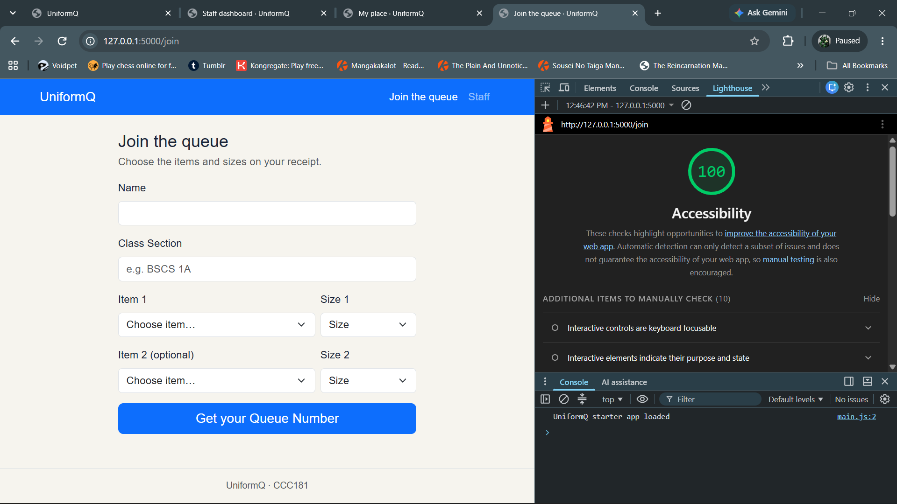
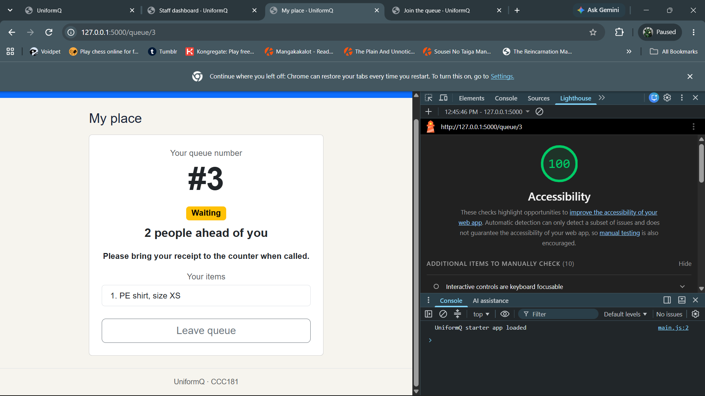
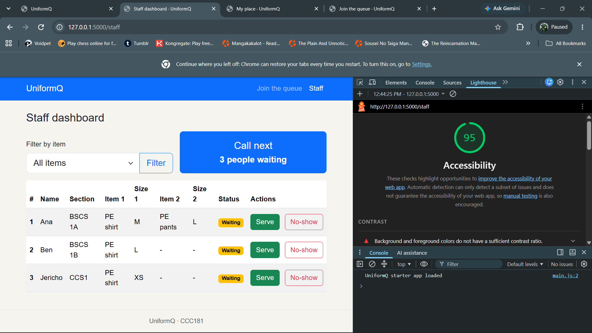
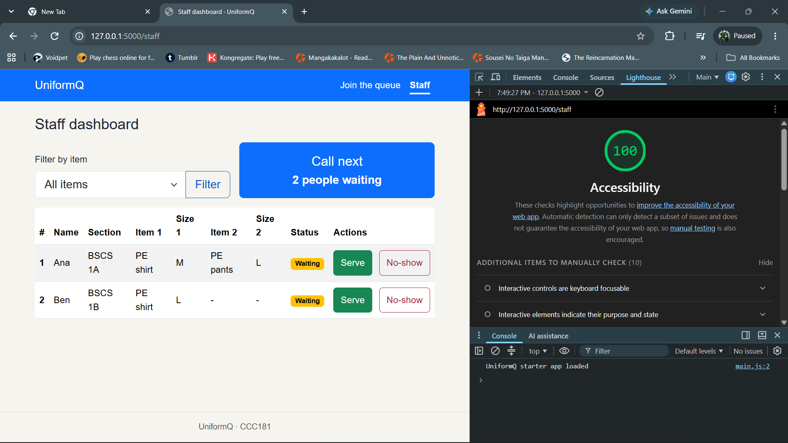

# Week 3 accessibility checks

The checks below cover all three screens: **Join queue**, **My place**, and
**Staff dashboard**.

## 9a. Lighthouse

Lighthouse accessibility scores (mobile):

| Screen | Before fixes | After fixes | Screenshot |
| --- | --- | --- | --- |
| Join queue | 100 | 100 |  |
| My place | 100 | 100 |  |
| Staff dashboard | 95 | 100 | Before:  After:  |

The Staff dashboard first scored 95. Lighthouse listed one failing item:
background and foreground colors without a sufficient contrast ratio. I changed
the inactive navbar link to white and darkened the text color of the No-show and
Filter buttons in `static/css/style.css`, then ran Lighthouse again and the
score was 100.

## 9b. Keyboard

All three screens can be used with a keyboard only. Tab moves through the
navigation links, form fields, dropdowns and buttons, and the focused
control is visibly identifiable. The skip link appears on the first Tab, and the
mobile navigation toggle is also keyboard reachable.

I completed both tasks without a mouse:

- Joined the queue from the home page, through Name, Class Section, Item 1,
  Size 1, Item 2 and Size 2, to Get your Queue Number.
- On the staff dashboard, filtered by item, pressed Call next, and served a
  student.

Problem found: it was not clear where the keyboard focus was on the navigation
links, or which page was active. Bootstrap turns off the focus outline on navbar
links. Fix: added a visible focus outline to every control and made the current
page's link bold and underlined.

## Manual checklist

| Check | Join | My place | Staff |
| --- | --- | --- | --- |
| Every input has a visible label | ✅ Name, Class Section, Item 1, Size 1, Item 2 and Size 2 have associated labels. | ✅ No user input fields on this screen. | ✅ The "Filter by item" dropdown has an associated label. |
| Error messages say what to do, in text | ✅ Validation messages say exactly what to enter or choose, such as "Enter your name." and "Choose a size." | ✅ No validation input on this screen. | ✅ No user-entered fields requiring validation on this screen. |
| Status is shown in words, not only color | ✅ No queue status is needed before joining. | ✅ Waiting, Called, Served, No-show and Left the queue are written in the status badge and in a sentence. | ✅ Waiting and Called are written in each status badge. |
| Text and buttons are readable at 375 px with no sideways page scroll | ✅ Verified at 375 px with no document overflow. | ✅ Verified at 375 px with no document overflow. | ✅ Verified at 375 px with no document overflow; only the table region scrolls horizontally. |
| Buttons are at least about 44 × 44 px on a phone | ✅ The navigation toggle and Get your Queue Number button are at least 44 px high. | ✅ The navigation toggle and Leave queue button are at least 44 px high. | ✅ Call next, Serve, No-show and the navigation toggle are at least 44 px high. |
| Page has one `<h1>` and headings in order | ✅ One h1: Join the queue. | ✅ One h1: My place. | ✅ One h1: Staff dashboard. |
| `<html lang="en">` (or your language) is set | ✅ `lang="en"` is set in the shared layout. | ✅ `lang="en"` is set in the shared layout. | ✅ `lang="en"` is set in the shared layout. |

## Fixes

- Increased the staff Serve and No-show buttons to a minimum height of 44px.
- Increased the mobile navigation toggle to 44 × 44px.
- Fixed the Staff dashboard contrast failure: navbar link color, and No-show and Filter button text colors.
- Made keyboard focus visible on every control, including the navbar links.
- Made the current page's navbar link bold and underlined.