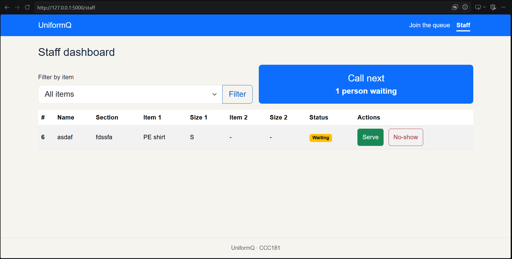
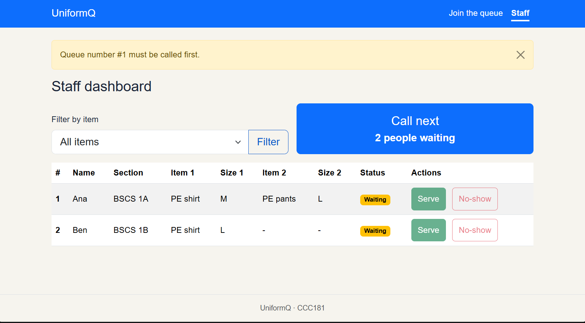

# UniformQ: Week 3 report

## Title details

- **App name:** UniformQ
- **Setting:** Claiming PE uniforms at the MSU-IIT Langkit University Shop
- **Full name:** Jeric I. Balos
- **Student ID:** 2024-0322
- **Section:** CS3
- **Date:** 11/4/2026
- **Pull request:** https://github.com/JekoBot/CCC181/pull/[number]

The Week 1 proposal was skipped in this course, so I wrote the requirement list in [`requirements.md`](requirements.md) this week. The IDs below (FR-01 to FR-07) come from that file.

## Personas

Full personas are in [`personas.md`](personas.md).

**Ana Ramos, the student waiting.** "I wondered why the location wasn't properly arranged from the beginning so we wouldn't have to stand under the sun for so long." (interview)
Top tasks: join the queue (FR-01), check my number and people ahead (FR-02), see when my turn is near without refreshing (FR-06), leave the queue (FR-07).

**Rey Mendoza, the staff member.** "People will cut in line, and I found the venue we used to be overcrowded." (interview)
Top tasks: see the waiting list in one queue order (FR-04), call the next student, mark them served or no-show (FR-05).

## Screens

Ana uses the Join screen to get a queue number with her name, section, items and sizes (FR-01, FR-03).

Ana can also join from a laptop, with the same form and the same checks (FR-01, FR-03).

Ana checks her queue number, status and people ahead here, and sees the receipt reminder (FR-02, FR-06, FR-07).

The same My place page on a laptop (FR-02, FR-06, FR-07).

Rey can use the dashboard on a phone, with the table scrolling sideways inside its box (FR-04, FR-05).

Rey's main screen is the laptop dashboard, with Call next, the waiting count and the queue table (FR-04, FR-05).

## Design decisions

1. **The queue number and people ahead are the biggest things on My place.** Ana said she couldn't tell how many people were ahead of her in a long line, so the queue number is the largest text on the screen and "2 people ahead of you" sits directly under the status badge.
2. **One queue order that staff cannot rearrange.** Rey said people cut in line, and students only have a sizing receipt that shows what they ordered, not who came first. The app gives each student a queue number, and the dashboard lists students in that order, with Call next as the main action.
3. **The dashboard shows name, section, items and sizes in each row.** Rey must not hand out the wrong size or misplace a receipt, so every row has what he needs to prepare the uniform before calling the student. Call next also shows how many students are waiting, because he said the venue was overcrowded.

## Self-review

The full review is in [`feedback.md`](feedback.md). The main problems I found in my wireframes, and what I changed:

- **Join:** the phone frame had no page title and nothing told students to copy the items and sizes from their receipt. I added the "Join the queue" heading and the line "Choose the items and sizes on your receipt."
- **My place:** the status looked like an ordinary field, the receipt reminder was easy to miss, and Leave queue had no confirmation. The status is now a badge that changes to Called, the reminder sits right under it, and Leave queue asks for confirmation.
- **Staff dashboard:** there was no Section column, no "now serving" display, and two ways to call a student. I added the Section column and a "Now serving" bar, kept Call next as the only way to call, and used "Serve" everywhere.

## Accessibility

| Screen | Lighthouse score (mobile) |
| --- | --- |
| Join queue | 100 |
| My place | 100 |
| Staff dashboard | 95 before fixes, 100 after |

The full results, the keyboard test and the checklist are in [`accessibility.md`](accessibility.md).

The most important issue I fixed came from the keyboard-only test: it was not clear where the focus was on the navigation links, or which page was active. Bootstrap turns off the focus outline on navbar links, so I added a visible outline to every control and made the current page's link bold and underlined. Lighthouse also flagged low contrast on the Staff dashboard, which I fixed by changing the navbar link and the No-show and Filter button colors.

## Usability test

One participant "Heidel", matching Ana, tried the app on laptop. They finished all three tasks without help.

| Task | Finished | Time | Observation |
| --- | --- | --- | --- |
| 1. Get in line | Yes | About 14 seconds | No hesitation. They said "Klaro ramn diay" ("Oh, it's actually clear."). |
| 2. Find people ahead and queue number | Yes | About 3 seconds | Found both immediately, no hesitation. |
| 3. Call the next student and serve them | Yes | About 5 seconds | They said "Pwede lagi ma serve bisag wala na call" ("It can be served even without being called."). |

**Rules that held up:** Ana's rule 1 (queue number and people ahead are the biggest things on My place), Ana's rule 3 (a quick, plain form on a phone) and Rey's rule 3 (a compact table with plain labels).
**Rule that did not hold up:** Rey's rule 1 (one queue order that staff cannot rearrange), because Serve was enabled on students who had not been called.

**Improvement made.** Staff could serve a student who had never been called, which skips the queue order and the Called status.
Fix: Serve and No-show are now disabled until a student has been called, and the server refuses them for anyone who is not in the Called state.

Before:

After:

This was one participant doing three short tasks. It shows the main flow is clear but does not test everything: Ana's rules 2 and 4 and Rey's rules 2, 4 and 5 were not covered. The full notes are in [`usability-test.md`](usability-test.md).

## Reflection

The hardest part was getting the design to match what my interviews showed. The shop's process changed in my head more than once as my interviewee corrected what they said about receipts, tickets and their laptop, and I had to update the personas, the form fields and the staff table each time. Smaller problems, like a Jinja template error and PowerShell blocking my virtual environment, also took time.

When the data moves to a database in Week 4, I will change the `TICKETS` list into a tickets table and a separate table for each ticket's items and sizes, since each ticket can have up to two items. The queue number will come from the database instead of `TICKETS[-1]["number"] + 1`. I will also store the time each student joined, because my self-review noted that staff cannot see arrival times.

## Declaration

Tool: Claude

Purpose: Help brainstorm interview questions, debug the Flask, Jinja and Bootstrap code (join form, My place page, staff dashboard and JavaScript), fix accessibility issues in the CSS (touch targets, contrast and keyboard focus), and help write the Markdown files.
