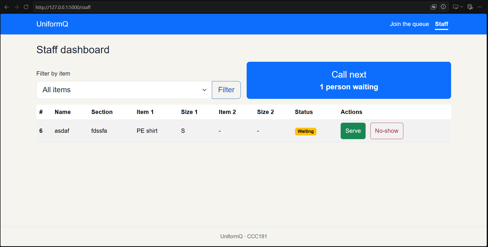
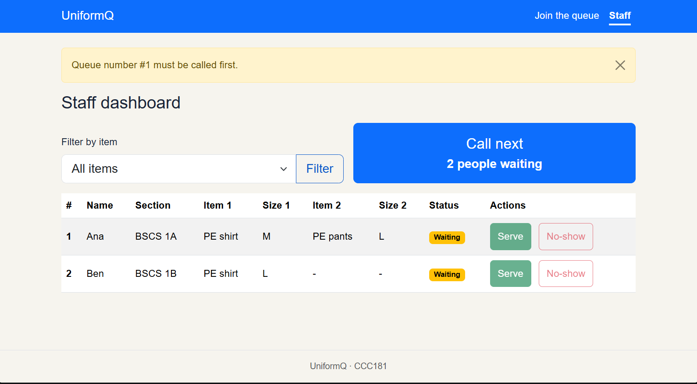

# Usability test

The participant was asked to think aloud and completed the three tasks without help. The complete flow took about 22 seconds.

Participant: Heidel
Matches persona: Ana
Device: laptop
Date: 11/04/2026

## Task 1
"You just arrived. Get in line for a PE shirt and PE pants."

* Finished: Yes
* Time: About 14 seconds
* Observation: The participant completed the form without hesitation. They said "Klaro ramn diay".
* Persona rules that held up: Ana's rule 3. The short, plain form worked on a phone and gave a queue number without an account or sign-up.
* Rules that did not hold up: None observed for this task.

## Task 2
"How many people are ahead of you? What is your queue number?"

* Finished: Yes
* Time: About 3 seconds
* Observation: The participant found the queue number and the people-ahead count immediately, with no hesitation or comment.
* Persona rules that held up: Ana's rule 1. The queue number and people ahead were the biggest things on My place.
* Rules that did not hold up: None observed for this task.

## Task 3
"Pretend you are the staff member. Call the next student and mark them as served."

* Finished: Yes
* Time: About 5 seconds
* Observation: The participant said "Pwede lagi ma serve bisag wala na call". Serve was enabled on students who had not been called.
* Persona rules that held up: Rey's rule 3. The compact table and plain labels made calling and serving quick.
* Rules that did not hold up: Rey's rule 1. Staff could serve a waiting student out of order, skipping the Called status.

## One improvement

Problem: A student can be served without being called first. This allows serving out of queue order and skips the Called status on the student's My place page.
Fix: Serve and No-show are now disabled until the student has been called, and the server refuses them for anyone who is not in the Called state.
Before: 
After: 
