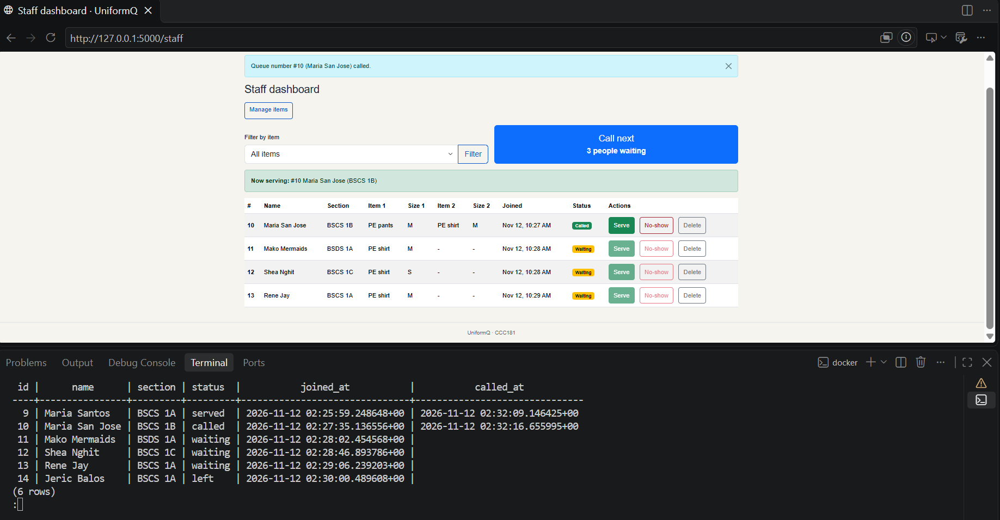
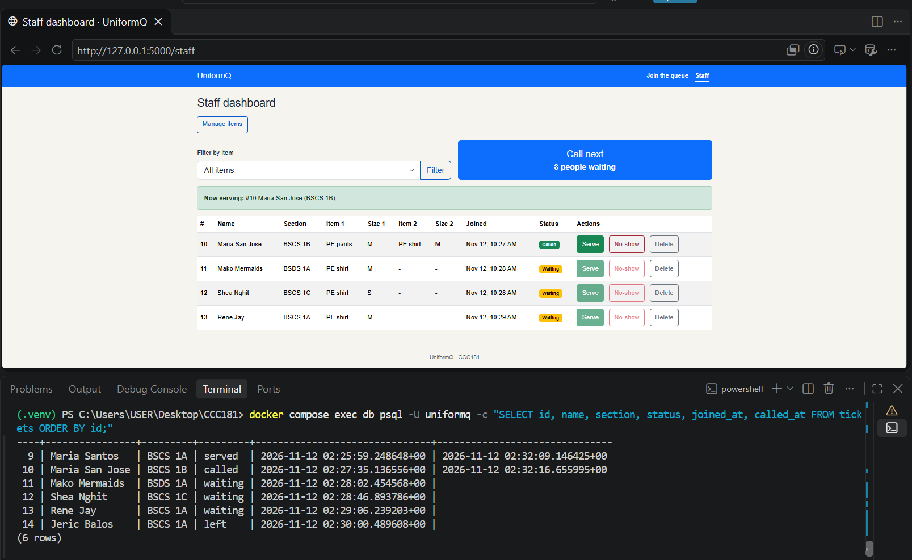

# Persistence

## Restart test

1. Created 6 tickets across both items.
2. Called one, served one, and one person left.
3. Before restart: 
4. Stopped Flask, ran `docker compose down`, then `docker compose up -d` and started Flask again.
5. After restart: 

Result: every ticket, status and time was the same. NFR-01 (no ticket is lost when the server or the database restarts) passed.

## Rebuild from scratch

Ran `docker compose down -v`, `docker compose up -d`, `flask --app app db upgrade` and `flask --app app seed`. 
Result: Database was rebuilt from scratch.