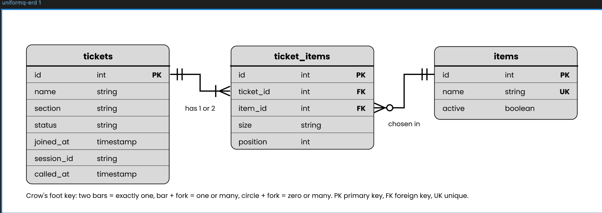
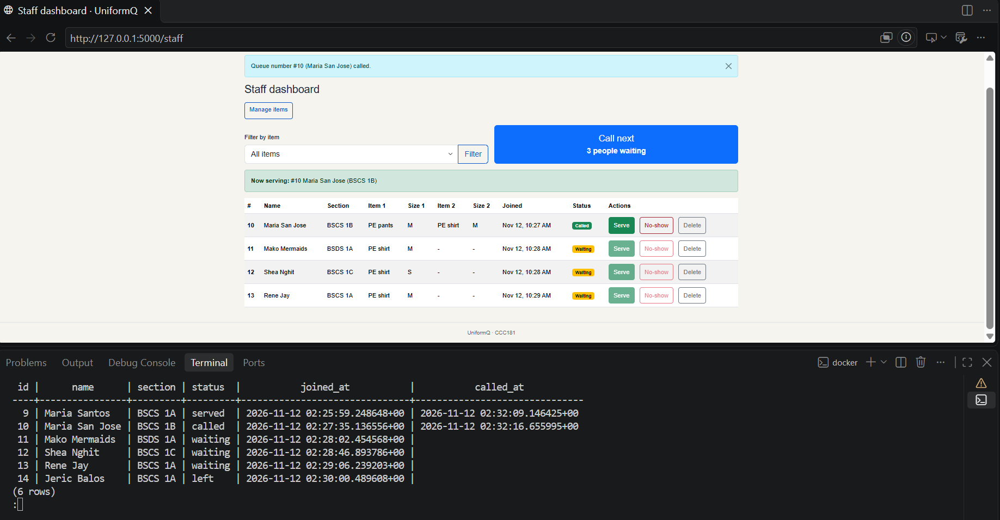
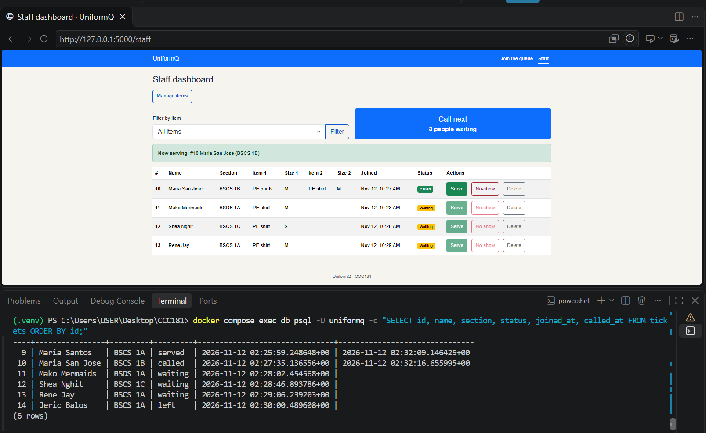

# UniformQ: Week 4 report

## Title details

- **App name:** UniformQ
- **Setting:** Claiming PE uniforms at the MSU-IIT Langkit University Shop
- **Full name:** Jeric I. Balos
- **Student ID:** 2024-0322
- **Section:** BSC3
- **Date:** 12/11/26
- **Database:** PostgreSQL 17 in Docker Compose

## Requirements
 
I wrote 16 functional and 7 non-functional requirements, with IDs, priorities and a *Stores data?* column. The MVP is FR-01,FR-02,FR-03,FR-04,FR-05, because it is the smallest version that gives a student a queue number, shows how many people are ahead, and lets staff serve students in order without losing a ticket on restart. Full list: [docs/requirements.md](../requirements.md)

I checked the list with a student claiming a uniform. They said “I need to know when to go, not just a count.", so I Kept FR-02, and My place now shows “almost your turn, make your way to the venue” and “go to the counter” states..

## ERD



One ticket has one or two ticket items. One item appears in many ticket items. Each ticket item belongs to exactly one ticket and one item. Full design: [schema.md](schema.md)

## Schema

```
                                   Table "public.tickets"
   Column   |           Type           | Collation | Nullable |           Default            
------------+--------------------------+-----------+----------+------------------------------
 id         | integer                  |           | not null | generated always as identity
 name       | character varying(80)    |           | not null | 
 section    | character varying(30)    |           | not null | 
 status     | character varying(20)    |           | not null | 'waiting'::character varying
 joined_at  | timestamp with time zone |           | not null | now()
 session_id | character varying(64)    |           | not null | 
 called_at  | timestamp with time zone |           |          |   
 Indexes:
    "tickets_pkey" PRIMARY KEY, btree (id)
    "ix_tickets_waiting" btree (joined_at) WHERE status::text = 'waiting'::text
    "one_active_ticket_per_session" UNIQUE, btree (session_id) WHERE status::text = ANY (ARRAY['waiting'::character varying, 'called'::character varying]::text[])
Check constraints:
    "ck_tickets_name_not_blank" CHECK (length(TRIM(BOTH FROM name)) > 0)
    "ck_tickets_section_not_blank" CHECK (length(TRIM(BOTH FROM section)) > 0)
    "ck_tickets_status" CHECK (status::text = ANY (ARRAY['waiting'::character varying, 'called'::character varying, 'served'::character varying, 'no-show'::character varying, 'left'::character varying]::text[]))
Referenced by:
    TABLE "ticket_items" CONSTRAINT "ticket_items_ticket_id_fkey" FOREIGN KEY (ticket_id) REFERENCES tickets(id) ON DELETE CASCADE
```

```
                              Table "public.ticket_items"
  Column   |         Type         | Collation | Nullable |           Default            
-----------+----------------------+-----------+----------+------------------------------
 id        | integer              |           | not null | generated always as identity
 ticket_id | integer              |           | not null | 
 item_id   | integer              |           | not null | 
 size      | character varying(3) |           | not null | 
 position  | smallint             |           | not null | 
Indexes:
    "ticket_items_pkey" PRIMARY KEY, btree (id)
    "uq_ticket_items_ticket_item" UNIQUE CONSTRAINT, btree (ticket_id, item_id)
    "uq_ticket_items_ticket_position" UNIQUE CONSTRAINT, btree (ticket_id, "position")
Check constraints:
    "ck_ticket_items_position" CHECK ("position" = ANY (ARRAY[1, 2]))
    "ck_ticket_items_size" CHECK (size::text = ANY (ARRAY['XS'::character varying, 'S'::character varying, 'M'::character varying, 'L'::character varying, 'XL'::character varying, '2XL'::character varying]::text[]))
Foreign-key constraints:
    "ticket_items_item_id_fkey" FOREIGN KEY (item_id) REFERENCES items(id) ON DELETE RESTRICT
    "ticket_items_ticket_id_fkey" FOREIGN KEY (ticket_id) REFERENCES tickets(id) ON DELETE CASCADE

```

```
                                 Table "public.items"
 Column |         Type          | Collation | Nullable |           Default            
--------+-----------------------+-----------+----------+------------------------------
 id     | integer               |           | not null | generated always as identity
 name   | character varying(60) |           | not null | 
 active | boolean               |           | not null | true
Indexes:
    "items_pkey" PRIMARY KEY, btree (id)
    "items_name_key" UNIQUE CONSTRAINT, btree (name)
Referenced by:
    TABLE "ticket_items" CONSTRAINT "ticket_items_item_id_fkey" FOREIGN KEY (item_id) REFERENCES items(id) ON DELETE RESTRICT

```

## Design decisions

1. **The queue number is the ticket's database id.** Students have no way to prove who arrived first, so the database assigns `tickets.id` with `GENERATED ALWAYS AS IDENTITY`. It is never reused, so two students never share a number (NFR-02), and "people ahead" counts waiting tickets with a smaller id.
2. **Each item on a ticket is its own row in `ticket_items`.** Students order up to two items with separate sizes, as my personas and wireframes show. A list in one column would break first normal form, so `size` and `position` sit on the row for each item, and a unique rule on `(ticket_id, position)` limits a ticket to two items.
3. **Leaving the queue is a soft delete, and a mistaken ticket is a hard delete.** Staff need to know how many students left before being served, so leaving sets the status to `left` and keeps the row (FR-07). A test ticket created by mistake can be removed for good, and `ON DELETE CASCADE` removes its item rows too (FR-14).

## Self-review

The full review is in [schema-review.md](schema-review.md). The main problems I found, and what I changed:

- **Items could not be switched off.** Staff could not delete an item with tickets, and leaving it on meant students could pick something nobody could hand out. I added `items.active`.
- **Two students joining at the same moment could share a `joined_at`.** I count people ahead by `tickets.id`, which is unique and always in join order, and kept `joined_at` for display and reports.
- **One active ticket per browser was only checked in the app.** Two quick submits could both pass the check. I added `tickets.session_id` and a partial unique index, so the database refuses the second ticket.

## Migrations

- `3848e9eaf926_initial_tables`: creates `items`, `tickets` and `ticket_items`, with their constraints and the two partial indexes.
- `1b843ecebafd_add_tickets_called_at`: adds a nullable `called_at` column to `tickets`, so staff can measure how long students wait before being called.

## CRUD

| Operation | Route | Requirement | Evidence |
| --- | --- | --- | --- |
| Create ticket | `POST /join` | FR-01 | The join form creates a ticket and its item rows in one commit. |
| Read ticket | `GET /queue/<ticket_id>` | FR-02 | My place shows the queue number, status, people ahead and items. |
| Read queue | `GET /staff` | FR-04 | [Dashboard screenshot](screenshots/persistence_check_before.png) |
| Update ticket status | `POST /staff/call-next` and `POST /staff/tickets/<ticket_id>/<action>` | FR-05 | Staff call, serve or mark a ticket no-show, and `called_at` is set when called.  |
| Update item | `POST /staff/items/<item_id>/edit` | FR-08 | Staff can rename an item or switch it off.  |
| Soft delete ticket | `POST /queue/<ticket_id>/leave` | FR-07 | The ticket stays in history with status `left`. |
| Hard delete ticket | `POST /staff/delete/<ticket_id>` | FR-14 | Staff can delete a mistaken ticket for good, and its item rows go too (`ON DELETE CASCADE`). |

The dashboard screenshot shows the persisted read state, including served, no-show, left, called and waiting tickets. Staff can also add and delete items (`POST /staff/items` and `POST /staff/items/<item_id>/delete`), and deleting an item that has tickets is refused. These actions are in [app.py](../../app.py). Every route that changes data is a POST.

## Validation

The full results are in [validation.md](validation.md). The browser limits what a student can type, Flask rejected four bad requests sent with curl (400, ticket count stayed at 2), and PostgreSQL refused every bad insert, one for each constraint type. The error I found most useful was `one_active_ticket_per_session`, because it enforces my own rule that a browser can only hold one active ticket, even if the app check is skipped.

## Persistence




Every ticket, status and time was the same after `docker compose down` and `up -d`, so NFR-01 passed. I also deleted the volume and rebuilt the database from my migrations with `flask db upgrade` and `flask seed`. Details: [persistence.md](persistence.md)

## Reflection

The most time consuming part was the changes I had to implement after finding a problem or when it was pointed out to me.


## Declaration

I used Claude (Anthropic) to help structure markdown file requirements, debug errors and checks, help add features, and brainstorming my requirements.

