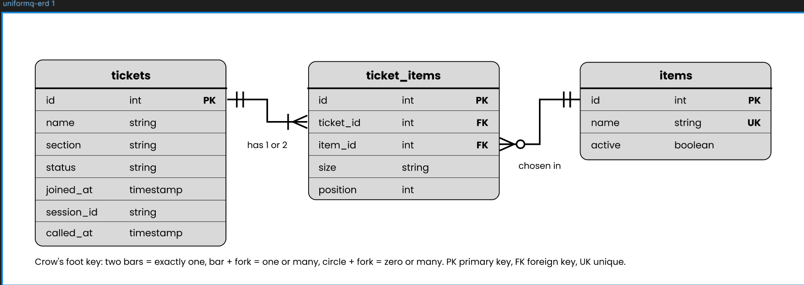

# UniformQ database schema

## 2a. Nouns in the requirements

| Req ID | Requirement | Nouns | Table or column? |
| --- | --- | --- | --- |
| FR-01 | A **student** can join the **queue** with their **name**, **section**, **items** and **sizes**. | student, queue, name, section, item, size | `tickets`, not a table, `tickets.name`, `tickets.section`, `items`, `ticket_items.size` |
| FR-02 | A student can see their **queue number**, **status**, and how many people are **ahead** of them. | queue number, status, ahead | `tickets.id`, `tickets.status`, computed |
| FR-04 | A staff member can see the waiting list in queue order, with each student's name, section, items and sizes. | waiting list, name, section, items, sizes | computed queue, `tickets`, `ticket_items` |
| FR-05 | A staff member can call the next student, mark them served, or mark them no-show. | staff member, student, status | `tickets.status` |
| FR-07 | A student can leave the queue. | student, queue, status | `tickets.status` |

The queue is not a table: it is every ticket with status `waiting`, ordered by `joined_at`. The number of people ahead is computed, not stored.

## 2b. Tables and columns

| Table | Columns |
| --- | --- |
| `items` | `id`, `name` |
| `tickets` | `id`, `name`, `section`, `status`, `joined_at` |
| `ticket_items` | `id`, `ticket_id`, `item_id`, `size`, `position` |

## 2c. Column types and constraints

| Table | Column | PostgreSQL type | Constraint | Why |
| --- | --- | --- | --- | --- |
| `items` | `id` | `integer GENERATED ALWAYS AS IDENTITY` | PRIMARY KEY | Gives every uniform item a stable identifier. |
| `items` | `name` | `varchar(60)` | NOT NULL UNIQUE | Prevents duplicate item names. |
| `tickets` | `id` | `integer GENERATED ALWAYS AS IDENTITY` | PRIMARY KEY | The queue number. The database assigns it, so it is never reused and two students never share one. |
| `tickets` | `name` | `varchar(80)` | NOT NULL, CHECK (length(trim(name)) > 0) | A ticket must have a student name, not blank spaces. |
| `tickets` | `section` | `varchar(30)` | NOT NULL, CHECK (length(trim(section)) > 0) | Staff match the ticket to the student's receipt by section. |
| `tickets` | `status` | `varchar(20)` | NOT NULL DEFAULT `'waiting'`, CHECK (status IN (`'waiting'`, `'called'`, `'served'`, `'no-show'`, `'left'`)) | Allows only known queue states. |
| `tickets` | `joined_at` | `timestamptz` | NOT NULL DEFAULT `now()` | Records when the student joined and keeps the queue order fair across time zones. |
| `ticket_items` | `id` | `integer GENERATED ALWAYS AS IDENTITY` | PRIMARY KEY | Identifies each item line on a ticket. |
| `ticket_items` | `ticket_id` | `integer` | NOT NULL, FOREIGN KEY REFERENCES `tickets(id)` ON DELETE CASCADE | Connects each item line to its ticket; a mistaken ticket can be deleted together with its items. |
| `ticket_items` | `item_id` | `integer` | NOT NULL, FOREIGN KEY REFERENCES `items(id)` ON DELETE RESTRICT | Prevents an item line from pointing to a missing item, and keeps old tickets readable. |
| `ticket_items` | `size` | `varchar(3)` | NOT NULL, CHECK (size IN (`'XS'`, `'S'`, `'M'`, `'L'`, `'XL'`, `'2XL'`)) | Allows only real uniform sizes. |
| `ticket_items` | `position` | `smallint` | NOT NULL, CHECK (position IN (1, 2)), UNIQUE (`ticket_id`, `position`) | Limits a ticket to two items. |
| `ticket_items` | `ticket_id`, `item_id` | | UNIQUE (`ticket_id`, `item_id`) | The same item cannot appear twice on one ticket. |

Every constraint type is used: PRIMARY KEY, FOREIGN KEY, NOT NULL, UNIQUE and CHECK, and `joined_at` is a `timestamptz`. Nothing that can be computed is stored: the position in line is counted from `status` and `joined_at`.

## 2d. ERD

One ticket has one or two ticket items. One item appears in many ticket items. Each ticket item belongs to exactly one ticket and one item.

| Foreign key | On parent delete | Reason |
| --- | --- | --- |
| `ticket_items.ticket_id` → `tickets.id` | `CASCADE` | A ticket's item lines have no meaning without the ticket, so deleting a mistaken ticket removes them too. |
| `ticket_items.item_id` → `items.id` | `RESTRICT` | Do not delete an item while old tickets still refer to it. Switch it off instead. |

## 2e. Normalization check

1. **One value per cell (1NF):** Yes. Each column holds one value. Items are not stored as a list such as `"PE shirt, PE pants"`; each item is its own row in `ticket_items`.
2. **Depends on the whole key (2NF):** Yes. In `ticket_items`, `size` and `position` describe one specific item on one specific ticket, so they depend on the whole row.
3. **No hidden copies (3NF):** Yes. Every non-key column in `tickets` describes that one ticket, and no column depends on another non-key column. An item's name is stored only in `items`. A student's name and section are stored on the ticket because students have no accounts, so nothing identifies the same student across tickets, and each ticket records who joined for that claim. Changing a name on one ticket does not require changing any other row. If students later get accounts or a student ID, I would move name and section into a `students` table.

## Duplicate tickets

A student who leaves, or who is served or marked as a no-show, can join again and gets a new ticket with a new queue number. The old ticket stays as a row, so reports such as "how many left before being served" still work.

The app stops a student from holding two active tickets at once. When a student joins, the ticket number is saved in their browser session. While that ticket is `waiting` or `called`, opening the join page sends them back to My place, and a submitted join form is refused. They can join again only after they leave or are served.

This is handled in the app and not by a database constraint, because the schema has no student identifier. It only controls one browser, so a student who uses a different browser or clears cookies could still join twice. This is a known limit.
